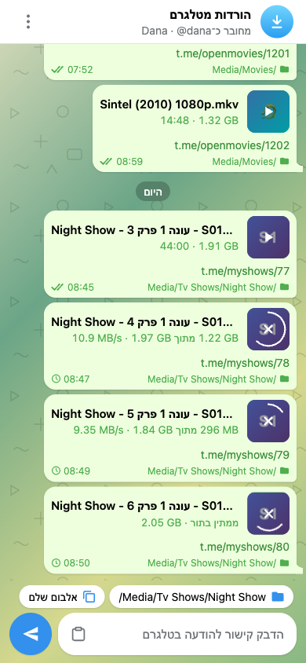
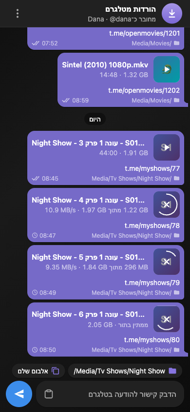
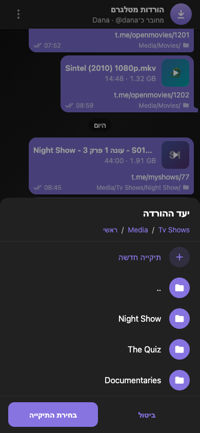
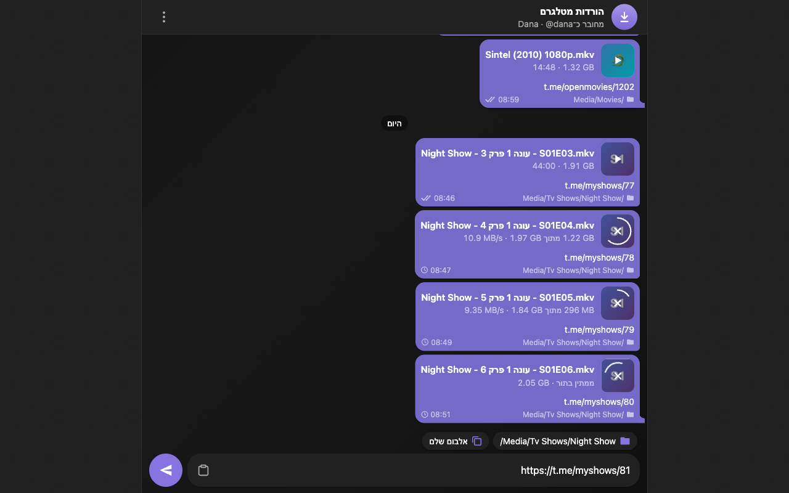
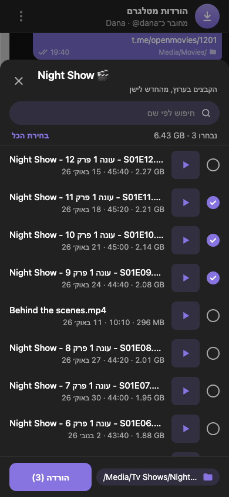
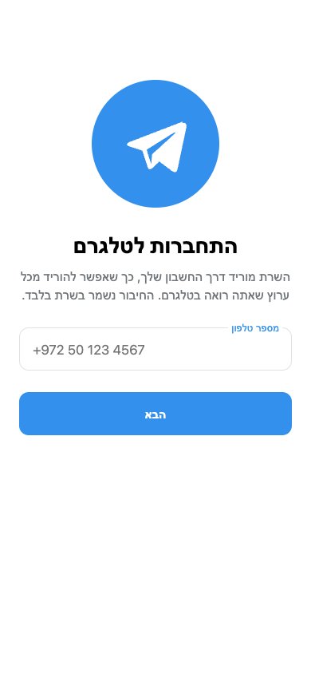

<div dir="rtl">

<p align="center">
  
</p>

<h1 align="center">TG Downloader</h1>

<p align="center">
  מדביקים קישור להודעה בטלגרם, בוחרים תיקייה, והסרטון יורד <b>ישר לשרת הביתי</b> (NAS, שרת מדיה, Raspberry Pi).<br>
  ממשק בעיצוב טלגרם, רץ ב־Docker.
</p>

<p align="center">
  
  &nbsp;
  
  &nbsp;
  
</p>

## מה זה עושה

- **הורדה מקישור:** מדביקים `https://t.me/channel/123` ושולחים. ההורדה מתחילה מיד.
- **ערוץ או קבוצה שלמים:** מדביקים קישור לערוץ, למשל `https://t.me/channel`, או להודעה שיש בה רשימת קישורים, ומקבלים את כל הקבצים ברשימה אחת. אפשר לחפש לפי שם, לסמן קבצים או לבחור הכל, ולהוריד בלחיצה אחת. כשבוחרים תיקייה של סדרה, כל פרק נכנס אוטומטית לתיקיית `Season 1`, `Season 2` וכן הלאה, לפי העונה שבשם (`עונה 2`, `Season 2` או `S02E05`). תיקיות עונה שכבר קיימות, כמו `עונה 2` או `Season 02`, נשמרות. אפשר לכבות את זה בכפתור "לפי עונות".
- **בחירת יעד:** בוחרים תיקייה בשרת, ואפשר גם ליצור תיקייה חדשה. האתר זוכר את הבחירה האחרונה.
- **שמות קבצים חכמים:** כשבכיתוב ההודעה יש עונה ופרק, למשל "הסדרה • עונה 1, פרק 6", הקובץ נשמר בשם
  `הסדרה - עונה 1 פרק 6 - S01E06.mkv`. התג `S01E06` עוזר ל־Jellyfin, Plex ו־Kodi לזהות את הפרק.
- **התקדמות בזמן אמת:** טבעת התקדמות, מהירות, תור והורדות במקביל. נגיעה ב־✕ מבטלת את ההורדה.
- **אלבומים:** הודעה עם כמה קבצים יורדת במלואה.
- **ערוצים פרטיים:** עובד גם עם `t.me/c/...`, בתנאי שהחשבון שלך חבר בערוץ.
- **אפליקציה במסך הבית:** אפשר להוסיף את האתר למסך הבית באייפון ובאנדרואיד, והוא נפתח עם אייקון משלו.
- **מצב בהיר וכהה** לפי הגדרות המכשיר, ומותאם לטלפון ולמחשב.

<p align="center">
  
</p>

<p align="center">
  
</p>

## איך זה עובד

השרת מתחבר לטלגרם **עם החשבון שלך**, כמו כל אפליקציית טלגרם נוספת שמחוברת לחשבון, דרך הספרייה [Telethon](https://github.com/LonamiWebs/Telethon).
לכן אפשר להוריד מכל ערוץ או קבוצה שאתה רואה, בלי בוט ובלי מגבלת הגודל של בוטים. החיבור נשמר רק בשרת שלך, בתיקייה `data`.

## התקנה

**צריך:** שרת עם Docker ו־Docker Compose.

```bash
git clone https://github.com/gluckgraphic-cell/tg-downloader.git
cd tg-downloader
cp .env.example .env
```

עורכים את `.env`:

| משתנה | מה זה | דוגמה |
|---|---|---|
| `DOWNLOADS_PATH` | התיקייה בשרת שממנה בוחרים יעד | `/volume1/Media` |
| `PUID` / `PGID` | הבעלים של הקבצים שיורדים. מריצים `id` בשרת כדי לראות את שלך | `1000` / `100` |
| `PORT` | הפורט של האתר | `8765` |
| `APP_PASSWORD` | סיסמה לאתר (לא חובה) | |
| `MAX_PARALLEL` | כמה הורדות רצות במקביל | `2` |

ומריצים:

```bash
docker compose up -d --build
```

האתר זמין בכתובת `http://<כתובת-השרת>:8765`.

### כמה תיקיות יעד

כדי לבחור יעד מכמה תיקיות נפרדות, למשל סרטים וסדרות על דיסקים שונים, מעתיקים את
`docker-compose.override.example.yml` ל־`docker-compose.override.yml` וממלאים את הנתיבים. Docker מחבר את הקובץ הזה לקובץ הראשי אוטומטית.

### NAS של UGREEN או Synology

- **הרשאות:** במערכת של UGREEN (UGOS), תיקיות הסל `#recycle` פתוחות רק למנהלים. מגדירים `PGID` לקבוצת המנהלים של המשתמש שלך (`id` מראה אותה, בדרך כלל `10`), ומוסיפים את הקבוצה `users` (`100`) בקובץ ה־override.
- **sudo:** אם המשתמש שלך לא בקבוצת `docker`, מריצים את הפקודות עם `sudo`.

## חיבור ראשון

<p align="center">
  
</p>

1. **מפתחות API:** נכנסים ל־<https://my.telegram.org>, בוחרים **API development tools** ויוצרים אפליקציה. השם לא משנה.
   מעתיקים את `api_id` ו־`api_hash` למסך ההגדרה באתר.
2. **טלפון וקוד:** מכניסים מספר טלפון, למשל `+972...`, ואת הקוד שטלגרם שולח לאפליקציה. אם יש אימות דו־שלבי, מכניסים גם את הסיסמה.
3. **הורדה:** בטלגרם לוחצים על הודעה ← **העתקת קישור**, מדביקים באתר ושולחים.

## הוספה למסך הבית

- **אייפון:** פותחים את האתר בספארי ← שיתוף ← **הוספה למסך הבית**.
- **אנדרואיד:** פותחים בכרום ← ⋮ ← **הוספה למסך הבית**.

## אבטחה

- האתר שולט בחשבון הטלגרם שלך, אז **אל תחשוף אותו לאינטרנט בלי סיסמה**. בבית הוא זמין רק ברשת המקומית.
  לגישה מבחוץ עדיף VPN, למשל Tailscale, או Cloudflare Tunnel עם `APP_PASSWORD`.
- בתיקייה `data` נשמר החיבור לחשבון. **לא משתפים אותה ולא מעלים אותה לגיט** (היא כבר ב־`.gitignore`).
- כדי לנתק את השרת מהחשבון: בתפריט ⋮ באתר ← "התנתקות מטלגרם", או בטלגרם עצמו בהגדרות ← מכשירים.

## מבנה הפרויקט

```
app/main.py              שרת FastAPI + Telethon: התחברות, הורדות, תיקיות
app/static/index.html    הממשק, קובץ אחד בלי תלויות
app/static/icons/        אייקונים למסך הבית
docker-compose.yml       הגדרת הקונטיינר
.env.example             כל ההגדרות
```

## שאלות נפוצות

**"אין גישה לערוץ"**: צריך להצטרף לערוץ עם החשבון שמחובר לשרת.

**ההורדה איטית**: המהירות תלויה בשרתים של טלגרם ובחשבון. משתמשי Premium מקבלים מהירות גבוהה יותר. אפשר להגדיל את `MAX_PARALLEL` כדי שיותר קבצים ירדו במקביל.

**הורדות נעצרו אחרי עדכון**: הפעלה מחדש של הקונטיינר עוצרת הורדות באמצע. עדיף לעדכן כשהתור ריק.

</div>

---

### English

**TG Downloader** is a self-hosted web app (Docker) with a Telegram-style UI. Paste a `t.me` message link, pick a folder on your server, and the media downloads straight to it through your own Telegram account (Telethon). Features: live progress and a queue, albums, private channels, a folder picker, `Show - S01E06` naming from captions, light and dark mode, and a home-screen app (PWA).

```bash
cp .env.example .env   # set DOWNLOADS_PATH, PUID/PGID
docker compose up -d --build
# open http://<server>:8765, enter api_id/api_hash from my.telegram.org, then your phone + code
```

Keep it on your LAN or behind a VPN. It controls your Telegram account.
